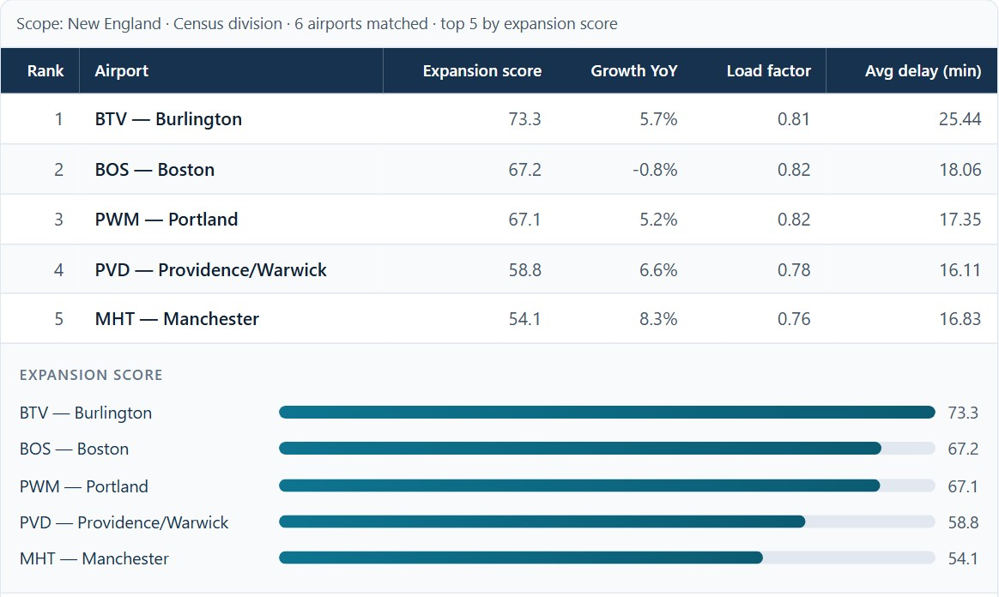
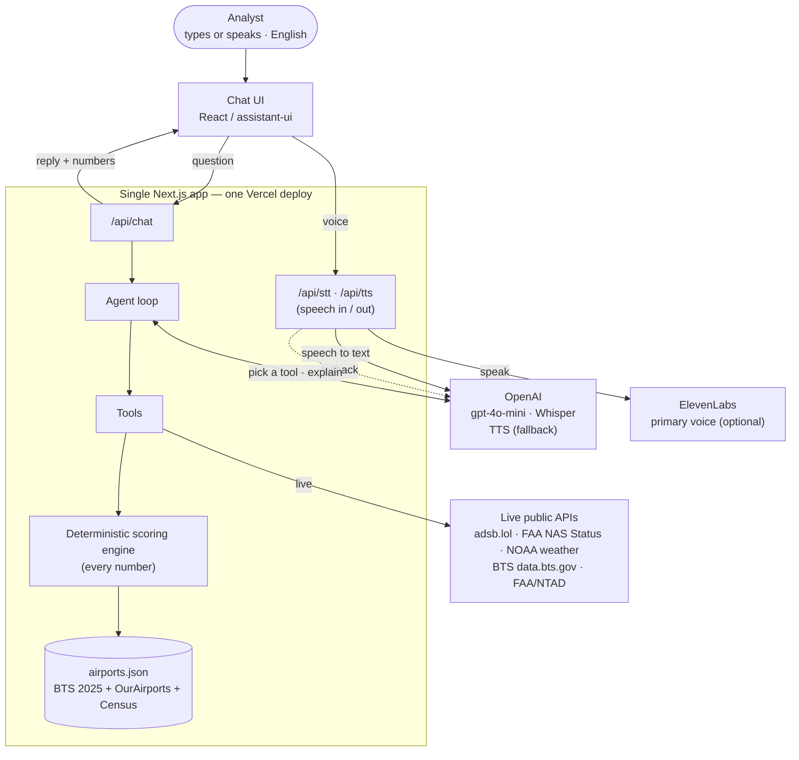

# Airport Investment Intelligence Agent

**Live demo:** https://airport-demo-pi.vercel.app
**Stack:** Next.js · TypeScript · OpenAI (tool calling, Whisper) · ElevenLabs (optional voice) · assistant-ui · Vitest

A chat assistant for analysts who invest in U.S. airport upgrades. You ask it questions
about airports in ordinary language, and it points you toward the ones with the strongest
**demand-side case** for a terminal expansion: places where demand is growing and starting
to run into the limits of what the airport can handle. (It scores demand-side opportunity,
not full profitability — see [what it doesn't do](#what-it-doesnt-do).)

You can type or talk to it. **The app is English-only** — both typing and voice.



*Live at [airport-demo-pi.vercel.app](https://airport-demo-pi.vercel.app) — try "Which airports in New England are strong candidates for terminal expansion?"*

## What you can ask

It was built around four questions to start with:

- Which airports in New England are strong candidates for terminal expansion?
- Compare LA and Santa Ana congestion levels.
- What share of flights out of Anchorage are long-haul?
- What's the unmet demand at SFO, and why?

It isn't limited to those, though. You can rank any region or state (including everyday names like the West Coast, the Gulf Coast or the Pacific Northwest, each with its stated list of states), compare any
airports side by side, pull up a single airport's full profile, check how many flights
are in the air near an airport right now, check current FAA delays and weather, look up
recent BTS traffic or runway facts, or just follow up on a previous answer.

Route-level questions are open-ended too, using real 2024 and 2025 route data from BTS T-100:

- Where does BOS fly, and which routes carry the most passengers?
- Is there nonstop service from BTV to SEA? What flies from BOS to Florida?
- Which airlines hold the most seats at OAK, or on OAK to LAX?
- Why did OAK's traffic fall? (Which carriers and routes cut seats between 2024 and 2025.)
- Which airports are in the Bay Area, and how busy are they?

These answers state what the data shows (who flies where, how many seats), never why an airline made a
choice, and "no nonstop service in this data" is a statement about scheduled segments, not a verdict that a market is underserved. When an answer is backed by data it comes with the numbers in a
small table (and a bar chart where that helps), along with a short note on the
assumptions behind the score and where the data came from.

## How it works

It's a single Next.js 14 app (App Router). The browser talks to the app's own routes
under `/api` (`chat`, `stt`, `tts`, `health`), so there's no separate backend to run and
no cross-origin setup to worry about.

Two parts split the work:

- The language model reads your question, decides which tool to call, and writes the
  explanation. It never makes up a number.
- A plain TypeScript scoring engine does the actual math (the congestion,
  unmet-demand, and expansion scores) and writes the assumptions and caveats. It's
  deterministic and covered by tests, so the figures stay the same from one run to
  the next.

How the assistant behaves:

- **Short, human answers.** A reply is two to four sentences that lead with the insight. The
  table is the evidence, so the reply never walks through its rows, names at most three
  airports and two figures, and adds a caveat only when it changes the conclusion.
- **Asks only when it has to.** It asks a question only when a place is genuinely ambiguous
  (Portland, New York); a misheard place with one clear reading is just answered, and the
  reply says how it was read.
- **Honest refusals.** Out-of-scope questions get one friendly line and one thing it can do,
  built from the coverage the tools returned. It never calls a market underserved, never says
  why an airline changed capacity (the data shows what changed, not why), and never gives a
  population figure: population is not part of this demo, and code replaces any answer that
  invents one.
- **Checked, not just instructed.** The code reads "top 3" and "least congested" from the user's own
  message, reads "Portland Oregon and Seattle" or a spelled-out "L A X" itself, and asks when a
  city has several airports. A written answer whose figures match nothing in the tool results, or
  that says an airline's decline was "driven by" a cause, gets one corrective retry and is never
  shown with the unsupported figure. Airline questions use a carrier filter that is stated in the
  result, so one airline's numbers are not reported as the airport's; an airline named in the question is applied even if the model forgot it. Calendar-year questions ("in 2025", "last year") are answered from calendar-year figures, never the live trailing 12 months. A follow-up like "DFW please" after "which Dallas airport?" is understood in context.
- **Follow-ups work.** The app remembers what was on screen last turn (the row labels in
  order), so "what about the second one?" resolves, and any figures come from a fresh tool call.
- **A voice that is checked.** The model also writes the line a voice reads aloud, and the
  server verifies it against that turn's tool results before it is returned. If it fails the
  check the app reads a plain summary built from the table instead. `SPOKEN_MODE=template`
  switches the model line off. Each response reports where time went (`meta.timings`).

Keeping the numbers out of the model's hands is the point. You can open the code and
see exactly how any score was produced, rather than trusting the model to have added
it up correctly.



The scoring is written up in [docs/DESIGN.md](docs/DESIGN.md), and the exact
request/response shape is in [docs/API_CONTRACT.md](docs/API_CONTRACT.md).

## Running it locally

You'll need Node 18+ and an OpenAI API key.

```bash
npm install
cp .env.example .env.local   # put your OPENAI_API_KEY in this file
npm run dev
```

Then open http://localhost:3000.

A few other scripts:

```bash
npm run build       # production build
npm run test        # unit tests for the scoring engine, data pipeline and tools
npm run typecheck   # type-check only
```

### Rebuilding the data

The data the scores use is built from official files by a reproducible pipeline (Node 18+,
no keys). Downloads are cached in the git-ignored `data/.cache/`, so a re-run is quick.

```bash
npm run build:data:staging  # 1. download BTS / OurAirports / Census files, aggregate, verify,
                            #    and preview what would change (data/staging/before_after.md)
npm run promote:data        # 2. re-verify, check every source checksum, write data/airports.json,
                            #    data/routes.json and data/places.json
npm run anchors             # 3. check the scoring anchors still match the rule (§3.0 of the design doc)
npm test
```

Run them in this order. `promote:data` reads `data/staging/`, which is git-ignored, so on a
fresh clone it fails until `npm run build:data:staging` has run. The app itself does not
need either step: the committed `data/*.json` files are what it reads.

If a refresh moves an anchor, `npm run anchors` and `lib/anchors.test.ts` both fail and
print the derived values to copy into `ANCHORS` in `lib/scoring.ts`. The T-100 download
drives a BTS web form; if BTS changes it, [scripts/ingest/README.md](scripts/ingest/README.md)
has the manual download steps.

## Voice

Tap the mic and just talk. It records your voice, transcribes it with OpenAI Whisper,
and sends the message; it auto-stops when you pause, so there's no second click. A status
chip shows the current stage (listening, transcribing, thinking, speaking), and the answer
to a spoken question is read aloud automatically with a natural voice (labelled "AI voice").
The voice is ElevenLabs when `ELEVENLABS_API_KEY` and `ELEVENLABS_VOICE_ID` are both set;
otherwise, and as the automatic backup for any request ElevenLabs cannot serve, it is OpenAI
text-to-speech. What is spoken is a short, natural line: the model's own wording when the
server's guard has checked every number and place name against this turn's tool results,
otherwise a plain sentence or two that code builds from the table you see on screen. A short
"one moment" covers a slow answer. Typed questions stay silent; each answer has a "Read aloud"
button. If audio is blocked or a step fails, the text answer is always on screen, with a "Play"
or "Retry" button where it helps. Add `?debug=voice` to the page address to see a small panel of the last 30 voice events and timings (names only, never speech content). Recording needs a browser with microphone support and a
secure (https or localhost) page; on a phone, open the https address.

**Conversation (hands-free).** Behind `NEXT_PUBLIC_CONVERSATION_MODE` (on unless set to `off`
at build time, which hides the button): press "Conversation" and just talk. It
listens, answers aloud, and listens again, with an End button always showing. You can talk over
it: while it speaks, starting to talk stops it and it listens to your new question, with your
first words kept. This relies on the browser's echo cancellation (so it does not mistake its own
voice, coming out of the phone speaker, for you) and on a detector that ignores leftover echo,
coughs and clicks; it works on many phones but not all. If it keeps interrupting itself it
switches itself off for the session and says once that headphones help; a tap on the speaking
indicator still interrupts, and headphones are the reliable answer in a loud room. It pauses
itself, with a message, after 8 seconds of silence, 3 empty turns, 10 turns without a tap, or when the page
is hidden or the screen locks; tap the mic to carry on. It keeps the screen awake while active
where the browser allows it.

## Authentication

Sign in with Google is optional and **off by default**. When it is on, only signed-in people
can use the paid routes (`/api/chat`, `/api/stt`, `/api/tts`); anyone with a Google account
may sign in. The flow is OAuth 2.0 authorization code with PKCE, plus OpenID Connect, written by
hand in `lib/auth/` (no auth framework; the one dependency is `jose`, for JWTs).

**Call order**

1. The browser opens `GET /api/auth/login`. The server makes three one-time secrets (`state`,
   `nonce`, PKCE `code_verifier`), keeps them in a signed 10-minute HttpOnly cookie, and redirects
   to Google with `response_type=code`, `client_id`, `redirect_uri`, `scope=openid email profile`,
   `state`, `nonce` and `code_challenge` (the SHA-256 of the verifier, `S256`).
2. The user signs in on Google's page and agrees to share their identity.
3. Google redirects the browser to `GET /api/auth/callback?code=...&state=...`.
4. The server checks `state` equals the one in the cookie (login CSRF defence).
5. The server (not the browser) POSTs the `code`, the `code_verifier`, the client id and secret and
   the redirect URI to Google's token endpoint and receives an `id_token`.
6. The server verifies the ID token against Google's public keys (JWKS): signature, issuer,
   audience (our client id), expiry, issue time and the `nonce`; and requires `email_verified`.
7. The server issues **its own** session JWT and sets it as an HttpOnly cookie. Google's tokens are
   never stored or logged; only the identity (`sub`, email, name, picture) is kept.
8. The browser lands on `/`. Every call to `/api/chat`, `/api/stt` and `/api/tts` now carries the cookie;
   the central guard `requireUser` verifies it (default deny) and answers `401 {"error":"unauthorized"}` otherwise.
9. `POST /api/auth/logout` clears the cookie; `GET /api/auth/me` tells the UI who is signed in.

**The JWTs**

| Token | Who issues it | Who checks it | How | Lifetime |
|---|---|---|---|---|
| Google ID token | Google | us, once, in the callback | RS256, Google's public keys (JWKS); `iss`, `aud` = our client id, `exp`, `iat`, `nonce`, `email_verified` | about 1 hour (we also require it to be under 10 minutes old) |
| Our session JWT (cookie `airport_session`) | us | us, on every protected request | HS256 with `AUTH_SECRET`; `iss` = `airport-demo`, `aud` = `airport-demo-api`, `sub` = Google id, `email`, `name`, `picture`, `iat`, `exp` | 8 hours |
| Login cookie (`airport_login`) | us | us, in the callback | HS256, `aud` = `airport-demo-login` (so it can never act as a session) | 10 minutes |

**Environment variables** (names only; values go in `.env.local` or the Vercel project, never in the repo)

| Variable | Purpose |
|---|---|
| `AUTH_REQUIRED` | The on/off switch: `true` turns the guard on. Unset or `false` = the app works exactly as without sign-in. |
| `AUTH_SECRET` | Signs our JWTs. 32+ random characters: `node -e "console.log(require('crypto').randomBytes(32).toString('base64url'))"` |
| `AUTH_URL` | The app's public origin (production: `https://airport-demo-pi.vercel.app`). The redirect URI is built from it, never from the request's Host header. https only, except `http://localhost`. |
| `GOOGLE_CLIENT_ID`, `GOOGLE_CLIENT_SECRET` | The OAuth client from Google Cloud Console (type: Web application). |

**Google Cloud Console.** Create an OAuth client ID of type *Web application*, with these
*Authorized redirect URIs* (exact match):

- `https://airport-demo-pi.vercel.app/api/auth/callback`
- `http://localhost:3000/api/auth/callback`

**On/off.** `AUTH_REQUIRED=false` (or removing it) and redeploying makes the app fully open again.
Vercel applies an environment-variable change to the next deployment, so after changing it redeploy
(or redeploy the previous deployment). Any value that is not clearly off (`false`, `0`, `off`, `no`, empty)
counts as on, so a typo locks the API rather than opening it.

**Reading the code.** Start at `lib/auth/login.ts` then `lib/auth/callback.ts`; the helpers they call are small:
`pkce.ts` (random values, PKCE, constant-time compare), `google.ts` (the two Google endpoints), `idToken.ts`
(verify Google's JWT), `jwt.ts` and `session.ts` (our JWT and the `requireUser` guard).

**Known limits** (accepted for a demo):

- *No revocation.* The session is a stateless JWT. Sign out deletes the browser's copy, but a copied
  cookie stays valid until it expires (at most 8 hours). The only server-side kill switch is rotating
  `AUTH_SECRET`, which signs everybody out.
- *Sign-in is not a spending cap.* Anyone with a Google account may sign in, so the guard stops anonymous
  scripts, not a determined user. There is no per-user rate limit; the bounds are the per-request input
  caps, the ElevenLabs character budgets and the provider spending limits.
- *Off means open.* `AUTH_REQUIRED` unset is "off" by design (it is the on/off switch), so deleting the
  variable reopens the app at the next deployment.
- *Preview deployments cannot sign in*, because the redirect URI always points at `AUTH_URL` (production).
  With `AUTH_REQUIRED=true` a preview is locked, not open.

## Deploying

Since it's just a Next.js app, Vercel is the easy path: import the repo, add
`OPENAI_API_KEY` to the project's environment variables, and deploy. Nothing else is
needed unless you turn on Sign in with Google (see Authentication above). Keys live in the environment and never go into the repo
(`.env.local` is git-ignored).

The live tools use free public APIs and need no key. The
data hosts have not yet been tested from a Vercel datacenter IP, so check the live tools
after the first deploy.

## Adding an area or more airports

Scopes are resolved by code from published geographic definitions (Census regions and
divisions, metro areas, or distance from a named place); the model only passes the scope
text, and the code tells it what is covered. Nothing about an area is hard-coded per airport.

- **A new named area** (for example "Texas Triangle"): add one row to `metro_aliases` in
  `data/geography.json` with its names, a center point and a radius in miles. Anyone can
  already say "near <city>" or "within N miles of <city or airport code>" without a new row.
- **Cities for "near <place>"** come from the Census Gazetteer (`data/places.json`, every
  place of 10,000+ people) plus the airports' own cities; the pipeline rebuilds it.
- **More airports**: raise the coverage in the pipeline and re-run it. Every state, Census,
  alias and distance scope picks them up from their state code and lat/lon, and each airport's
  Census metro area (CBSA) makes "Boston metro" or a CBSA code a scope too.
- Run `npm test`; `lib/geography.test.ts` includes a 150-airport fixture.

## Project layout

```
app/
  api/chat/route.ts     the agent turn (POST /api/chat)
  api/stt/route.ts      speech to text (POST /api/stt, OpenAI Whisper)
  api/tts/route.ts      text to speech (POST /api/tts, ElevenLabs with OpenAI fallback)
  api/health/route.ts   a health check
  api/auth/*/route.ts   Sign in with Google: login, callback, logout, me (the logic is in lib/auth/)
  layout.tsx, page.tsx  the app shell and the single chat page
  globals.css           design tokens and Markdown styles
components/
  assistant/            the chat UI, built on assistant-ui
  StructuredResult.tsx  the results table and bar chart
  AssumptionsPanel.tsx  the assumptions / uncertainty panel
lib/
  auth/                 Sign in with Google by hand: PKCE, ID token check, our session JWT, the requireUser guard (README "Authentication")
  agent.ts              the model loop (chat model and tool calling; speech is in the stt/tts routes)
  tools.ts              the tools the model can call
  scoring.ts            the deterministic scoring engine and its anchors
  anchors.ts            the anchor rule (5th/95th percentile) as code
  data.ts               access to the bundled dataset and Census gazetteer
  routes.ts             lazy, server-only loader for the route table
  routeTools.ts         the route tools: route_search, carrier_share, capacity_trend, airport_search
  toolScope.ts          shared scope handling for tools (user's words first, honest failures)
  carriers.ts           carrier names from the BTS carrier lookup (raw code when unknown)
  geography.ts          resolves scope text (Census region/division, state, metro, "near <place>") to airports
  liveflights.ts        live ADS-B client (adsb.lol) for the "flights right now" tool
  live/                 live public-API tools (FAA status, NOAA weather, BTS traffic, FAA infrastructure) with mocked-fetch tests and real-capture fixtures
  i18n.ts               the code-owned assumption and label text
  chatModelAdapter.ts   connects assistant-ui to /api/chat
  spoken.ts             builds the spoken summary from the structured result
  voicePlayback.ts      sentence-by-sentence TTS playback queue, cancel, tap-to-hear
  endpointing.ts        decides when the speaker has finished (noise-floor calibrated)
  voiceStatus.ts        derives the voice status chip state
  conversation.ts       the hands-free Conversation state machine (pauses, End, interrupt)
  micSession.ts         one microphone stream and audio context, opened inside the user's tap
  wakeLock.ts           keeps the screen on during a conversation (feature-detected)
  spokenGuard.ts        checks the model's voice line against this turn's tool results
  sentences.ts          abbreviation-safe sentence splitting
  acknowledgement.ts    the cached "one moment" phrases
  transcript.ts         rejects ghost transcripts ("Thank you." from silence)
  speechSynthesis.ts    server TTS provider switch, fallback and credit guards
  limits.ts             in-memory character budget and concurrency cap
hooks/
  useDictation.ts       records audio and transcribes it (Whisper), auto-stop on silence
  useConversation.ts    wires the Conversation state machine to the microphone, player, wake lock and page visibility
  useSpeechPlayback.ts  React binding for the playback queue
scripts/
  ingest/               the data pipeline: download, aggregate, verify, preview (see its README)
  promote-data.mjs      verifies the staging build and writes data/*.json
  derive-anchors.mjs    applies the anchor rule to the data and compares with lib/scoring.ts
data/airports.json      102 airports with per-field provenance in its meta block
data/routes.json        origin x destination x carrier rows, 2024-2025 (route tools only)
data/carriers.json      BTS carrier code to airline name for the carriers with 99% of seats, with its source
data/places.json        Census Gazetteer places of 10,000+ people
data/geography.json     Census regions/divisions, state codes, named metro aliases
docs/                   the design doc, the API contract and the data provenance table
```

## Where the data comes from

Every number comes from an official or open source; nothing is hand-typed. The full
"where every number comes from" table is in [docs/data-provenance.md](docs/data-provenance.md).

| Source | What it provides | When |
|---|---|---|
| **BTS T-100 Segment (All Carriers)** | passengers (domestic + international), departures, load factor, haul mix, 2025 vs 2024 growth, route table | build time, calendar year 2025 |
| **BTS On-Time Reporting Carrier** | average departure delay, share delayed 15 minutes or more, cancellation rate | build time, calendar year 2025 |
| **OurAirports** | name, city, state, coordinates, open runways | build time |
| **U.S. Census Bureau** (Geocoder, Gazetteer, population estimates) | each airport's metro area (CBSA); city names and coordinates for "near <city>" | build time |
| **adsb.lol** | live aircraft near an airport, on request | live |
| **FAA NAS Status** | current ground stops, delay programs, closures | live (lists only active programs) |
| **NOAA Aviation Weather Center** | current METAR and TAF | live |
| **BTS T-100 summary** (data.bts.gov API) | trailing-12-month passengers, departures, seats, load factor, growth | live (lags several months) |
| **FAA / USDOT NTAD** | runways, tower type, Part 139 class | live |

Build-time sources are downloaded, checksummed and aggregated by the pipeline above;
`data/airports.json` carries each field's source, table, period, retrieval date and
formula in its `meta` block. Live sources are queried only when a question needs them,
and each answer states its source, period and retrieval time. Scores and rankings never
use the live figures: they come from the bundled dataset so they stay reproducible, so a
live number can legitimately differ from the dataset's because the periods differ.

**Coverage:** 102 airports, the 100 busiest U.S. airports by 2025 enplanements plus
Burlington (BTV) and Manchester (MHT), together 93.9% of U.S. scheduled passenger
enplanements; 49,858 route rows; 3,224 Census places.

What costs money to run: the OpenAI calls (required: chat, speech-to-text and the fallback
voice) and, if you turn it on, ElevenLabs credits (an optional paid plan). All data sources need no key. Because both paid providers can be
called by anyone who can reach the API, see [Known limitations](#known-limitations).

## What it doesn't do

The scores look at the demand side only: how much traffic an airport has and how
close it is running to its limits. They don't factor in construction cost, available
land or gates, or local rules such as noise curfews, all of which a real investment
decision would weigh. Every answer says so, so the numbers aren't taken for more than
they are.

## Known limitations

- **No authentication or rate limiting** on the `/api` routes. Chat, speech-to-text, and
  text-to-speech each trigger paid calls (OpenAI, and ElevenLabs credits when configured),
  so a public deployment is exposed to cost abuse. Each route bounds its input: chat takes a
  message of up to 1,000 characters and the last 12 turns; speech-to-text takes at most 1 MB of
  audio in a few allowed formats; text-to-speech takes at most 600 characters, with a
  per-client hourly budget (3,000 characters) and a global daily budget (8,000 characters)
  shared by both voice providers, plus a concurrency cap (3), all configurable. Requests a
  browser marks as cross-site are refused. There is no `GET` form of the speech route.
- **The voice guards are a speed bump, not security.** The budgets are held in memory, so
  each serverless instance counts separately and they reset on restart, and the client key
  comes from a forwarded header that can be spoofed outside Vercel (which overwrites it), and
  1,001 distinct client ids evict the oldest bucket. The ElevenLabs monthly allowance
  depends on the plan in use, so set the daily budget below it. Real authentication is the
  next step.
- **Conversation history is not signed.** The client sends the earlier turns and the
  "shown on screen" note, and the server validates their shape and size only. Figures still
  come from tool calls.
- **Next.js 14.** Most published advisories for it concern features this deployment does not
  use (the image optimizer, middleware). An upgrade is planned.
- **Scores are relative to large U.S. airports.** Each input is scaled between its 5th
  and 95th percentile across the 102 airports, so 50 means mid-pack among them, not an
  absolute condition. Anchors are re-derived (and tested) whenever the data is refreshed.
- **Delays cover the large reporting carriers only** (and their regional partners), on
  domestic flights, as 2025 annual averages. A smaller airport's delays often originate at
  the hubs it feeds, and rates are compared per flight, so small airports such as
  Burlington or Knoxville can rank near the top.
- **Growth is a single year** (2025 vs 2024). It was a soft year: 53 of the 102 airports
  carried fewer passengers than in 2024.
- **Thin data is never defaulted.** A rate resting on fewer than 5,000 scheduled
  departures (On-Time) or 365 departures (T-100) is suppressed and the score is shown as
  insufficient data. All 102 airports currently clear both thresholds.
- **Live sources have limits.** FAA NAS Status lists only airports with an active program,
  so "none reported" is not "no delays"; BTS T-100 lags real time by several months; FAA
  closure entries are NOTAM text and can be general-aviation only. A live source can be down, in which case the agent
  says so and falls back to the dataset.
- **Load factor carries real weight.** It enters unmet demand (40%) and expansion (25%)
  exactly once, because the congestion score does not include it. The full breakdown is in
  [docs/DESIGN.md](docs/DESIGN.md#35-effective-weights).
- **Coverage** is 102 airports; smaller airports are not in the dataset.

## Next steps

- Authentication, per-client rate limiting, and usage caps on the API.
- An end-to-end evaluation suite to catch regressions when prompts or models change.
- Multi-year growth trends and FAA ASPM demand-vs-capacity data from the same pipeline.
- Fare data (BTS DB1B) to test "underserved by demand" against real fares and itineraries,
  and delay-cause data to separate weather from capacity-driven delay.
- Observability: request logs, tool traces, latency, and cost metrics.
