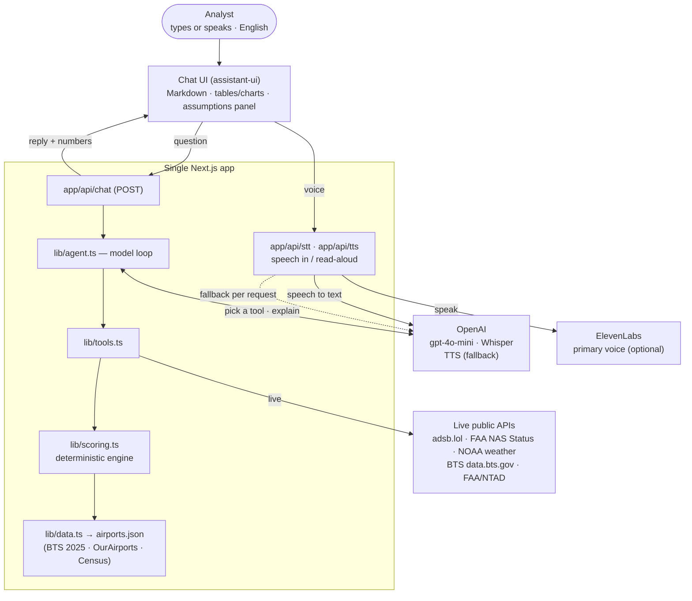

# Design & Architecture — Airport Investment Intelligence Agent

This is the design write-up for the agent that helps analysts find U.S. airports
where the demand-side case for a terminal expansion is strongest, i.e. where demand is growing
into the limits of what the airport can handle.

It walks through how the scoring works, the tradeoffs behind the design, where the
AI actually sits in the system, and the data behind it all.

---

## 1. What it does

An analyst chats with the agent in natural language (typed or by voice) and asks
questions like:

| Question | How it's answered |
|---|---|
| Which New England airports are strong candidates for terminal expansion? | `rank_airports(scope="new_england", metric="expansion")` |
| Compare LA and Santa Ana congestion levels. | `compare_airports(["LAX","SNA"], metric="congestion")` |
| What % of flights out of Anchorage are long-haul? | `long_haul_breakdown("ANC")` |
| What is the unmet flight demand at SFO, and why? | `unmet_demand("SFO")` |

Every answer shows the natural-language explanation, a structured table/chart, and
an **assumptions & uncertainty** panel. It can also pull live data on request — asking
"how many flights are in the air near SFO right now" calls a live ADS-B API in real time.

---

## 2. Architecture

A **single Next.js (TypeScript) application**. The chat UI and the agent API live in
one codebase and deploy as one unit — the browser calls the app's own `/api` routes
(same-origin, no CORS, no separate backend to host). The app is **English-only**, in
both the typed and the voice paths.



The code is split into small layers, each with one job:

- `app/api/chat/route.ts` — the HTTP boundary. It validates the input, hands off to the
  agent, and always returns something the UI can render, even on error. It runs on the
  Node.js runtime because the OpenAI SDK needs it.
- `app/api/stt/route.ts`, `app/api/tts/route.ts` — voice: Whisper transcription and
  text-to-speech (ElevenLabs when configured, OpenAI as the fallback; provider switch and
  credit guards in `lib/speechSynthesis.ts` and `lib/limits.ts`).
  `app/api/health/route.ts` — liveness and data vintage.
  The exact shapes are in [API_CONTRACT.md](API_CONTRACT.md).
- `lib/agent.ts` — the model loop (up to `MAX_AGENT_STEPS` model/tool iterations per
  turn). It handles language and orchestration and nothing else. The chat model calls
  live here; speech calls live in the stt/tts routes.
- `lib/tools.ts` — the tools the model is allowed to call. Every number the user sees
  comes from here.
- `lib/scoring.ts` — the scoring engine: plain functions, no I/O, no model. Its anchors
  come from the rule in `lib/anchors.ts` (§3.0).
- `lib/data.ts` — reads the bundled dataset and the Census places gazetteer (imported as
  JSON, so it works in any runtime without touching the filesystem). `lib/routes.ts`
  loads the larger route table lazily for route-level tools.
- `lib/geography.ts` — turns scope text into airports (§7).

Splitting it this way means `scoring.ts` and `data.ts` can be unit-tested on their own,
without the model in the loop, which is where the trust in the numbers comes from.

---

## 3. Scoring methodology

The scoring is deterministic — computed in code, not produced by the LLM. All scores
are **transparent weighted sums** of sub-metrics, each scaled to 0–1 between two
**anchors** and reported on a 0–100 scale.

### 3.0 The anchor rule

Every anchor comes from one rule, stated in two sentences:

> Each input is scaled linearly from 0 at its **5th percentile** to 1 at its **95th
> percentile** across all airports in the dataset, with both anchors rounded outward to
> two significant figures. Values beyond an anchor are clamped, so a single extreme airport
> cannot stretch the scale for everyone else.

Why this rule rather than hand-picked "domain" anchors: the real 2025 data broke most of
the old ones (no airport came near a 30-minute average delay or a 5% cancellation rate,
19 of the original 28 airports had negative growth that a 0-to-10% scale flattened to
zero, and load factor sat in a narrow 0.71–0.84 band that a 0.70–0.90 scale barely
separated). Anchoring on the real distribution gives every input roughly the same spread
(standard deviation about 0.3 on the 0–1 scale), so **the published weights are also the
effective weights**: no input dominates simply because its numbers happen to vary more.
The 5th/95th percentiles (rather than min/max) keep one outlier such as Burlington's
25-minute average delay from compressing everyone else; rather than the 10th/90th, they
leave only about five airports clamped at each end, so the top of a ranking keeps its
resolution.

The anchors are **frozen as constants** in `lib/scoring.ts` (`ANCHORS`) so a score means
the same thing whichever scope is asked about (ranking New England does not re-scale
against New England). They are not tuned by hand: `lib/anchors.test.ts` re-derives them
from `data/airports.json` and fails if they differ, and `npm run anchors` prints the
derived values after a data refresh.

| Input | Low anchor (scores 0) | High anchor (scores 1) | Source |
|---|---|---|---|
| Average departure delay | 10 min | 22 min | BTS On-Time, 2025 |
| Share of departures delayed 15 minutes or more | 14% | 26% | BTS On-Time, 2025 |
| Cancellation rate | 0.51% | 2.6% | BTS On-Time, 2025 |
| Load factor (passengers / seats) | 0.73 | 0.83 | BTS T-100 Segment, 2025 |
| Passenger growth, 2025 vs 2024 | −8.4% | +6.6% | BTS T-100 Segment, 2024–2025 |
| Annual passengers (enplaned, all carriers) | 1.2 M | 31 M | BTS T-100 Segment, 2025 |
| Departures per open runway | 4,800 | 69,000 | BTS T-100 Segment + OurAirports |

Scaling is **two-sided**: a declining airport scores below a flat one, and a steeply
declining one below a mildly declining one.

**Missing inputs are never defaulted.** The pipeline suppresses a rate (writes null) when
it rests on too few flights: fewer than 5,000 scheduled departures in the On-Time data, or
fewer than 365 departures in T-100. A score that needs a suppressed input is reported as
**insufficient data**, naming the missing input; rankings leave that airport out and say
so in the caption ("1 not scored (insufficient data)"), comparisons show "insufficient
data" in the score cell. In the 2025 data every one of the 102 airports clears both
thresholds, so today this path is exercised by tests only.

### 3.1 Congestion index (0–100)

Operational strain, judged as **rates** so large hubs and small airports are
comparable:

| Component | Weight |
|---|---|
| Share of departures delayed 15 minutes or more | 0.4375 |
| Average departure delay | 0.375 |
| Cancellation rate | 0.1875 |

Load factor is deliberately not part of congestion. The unmet-demand and expansion
scores already weight it directly, so including it here would count it twice. The
three weights above are the original 0.35 / 0.30 / 0.15 divided by 0.8 so they still
sum to 1.

### 3.2 Long-haul mix

Not a score but a breakdown: share of scheduled passenger **departures** by great-circle
segment distance — short (<1,100 mi), medium (1,100–2,200), long (>2,200) — from BTS
T-100 Segment 2025, all carriers, international segments included (someone asking for
the long-haul share out of JFK means its transatlantic flights too).

### 3.3 Unmet-demand proxy (0–100)

"Unmet demand" is not directly measurable in free data, so it's an explicit
**composite lower-bound proxy**:

| Driver | Weight | Rationale |
|---|---|---|
| Load-factor pressure | 0.40 | Sustained high seat use ⇒ demand supply can't absorb |
| Congestion | 0.35 | Delay/throughput gap ⇒ demand above capacity |
| Growth vs. capacity | 0.25 | Growth against fixed runways ⇒ widening gap |

"Growth vs. capacity" is itself `0.6 × passenger growth + 0.4 × departures per open
runway`, both scaled by the anchor rule.

### 3.4 Expansion attractiveness (0–100) — the headline demand-side score

The thesis: the demand-side case for expansion is strongest where **strong, growing
demand meets a capacity-constrained airport**, so renovation unlocks revenue rather
than adding idle space. This is a **demand-side opportunity** score, not a
profitability estimate — it deliberately doesn't model construction cost, land/gate
availability, or financing (see §6).

| Component | Weight | Why it matters to the investment |
|---|---|---|
| Demand growth | 0.30 | Future demand to justify the build |
| Congestion | 0.30 | Strain today that expansion would relieve |
| Load-factor pressure | 0.25 | Seats already scarce |
| Passenger volume upside | 0.15 | Scale of travelers who benefit |

Passenger volume counts **every enplaned passenger, domestic and international, on all
carriers** (U.S. and foreign). A terminal serves every departing passenger, so splitting
international out would understate gateways such as JFK (55% international), MIA (44%) or
SFO (29%) without changing what the score is for. The international share is still
reported per airport (`international_passenger_share`) for context.

### 3.5 Effective weights

The congestion score is itself an input to the unmet-demand and expansion scores, and
growth vs. capacity blends two inputs. Flattened to the underlying inputs:

| Input | Congestion | Unmet demand | Expansion |
|---|---|---|---|
| Load-factor pressure | — | 40.0% | 25.0% |
| Share delayed 15 minutes or more | 43.75% | 15.3125% | 13.125% |
| Average departure delay | 37.5% | 13.125% | 11.25% |
| Cancellation rate | 18.75% | 6.5625% | 5.625% |
| Passenger growth | — | 15.0% | 30.0% |
| Departures per open runway | — | 10.0% | — |
| Passenger volume | — | — | 15.0% |

Load factor enters unmet demand and expansion exactly once, so its effective weight
equals its documented weight (40% and 25%). Because every input is scaled by the same
percentile rule, these percentages are also the inputs' real influence on the ranking.

---

## 4. Where and how AI is used

The short version: the model handles language, the code handles numbers.

The model (OpenAI's `gpt-4o-mini`) reads the analyst's question, works out which tool
to call and with what arguments, keeps track of the conversation for follow-ups, and
explains the results in plain prose. That's it. Every metric, ranking, and score comes
from the scoring engine, and so does the assumptions and uncertainty text.

This is deliberate. The assumptions, the caveats, and the numbers in the table are all
pulled from the code, not written by the model (`lib/agent.ts` gathers them from each
tool call). A confused model reply might be unhelpful, but it can't quietly invent a
figure or drop a caveat, because it never had its hands on the numbers in the first
place. The loop is also capped (`MAX_AGENT_STEPS`) so it can't run away.

---

## 5. Data sources

Two kinds of data feed the agent; [data-provenance.md](data-provenance.md) has the
plain-language "where every number comes from" table.

**Build-time data (the scores).** A reproducible pipeline downloads official files, keeps
each download's URL, retrieval time and SHA-256, aggregates them, and writes a staging
build; a separate promotion step verifies it and writes the files the app reads:

```
npm run build:data:staging   # download (cached) + aggregate + verify + preview the diff
npm run promote:data         # verify again, check every checksum, write data/*.json
npm run anchors              # confirm the scoring anchors still match the rule
npm test
```

| Field | Source | Period |
|---|---|---|
| Passengers, departures, seats → load factor, haul mix, international share | **BTS T-100 Segment (All Carriers)**, scheduled passenger service (class F, freight-configured aircraft excluded) | calendar year 2025 |
| Passenger growth | the same table, 2025 vs 2024 | 2024–2025 |
| Average delay, share delayed 15 minutes or more, cancellation rate | **BTS On-Time Reporting Carrier** performance, by origin airport | calendar year 2025 (12 monthly files) |
| Name, city, state, coordinates, ICAO, open runways | **OurAirports** (public domain) | snapshot at retrieval |
| Metro area (CBSA title and code) | **U.S. Census Geocoder**, point-in-polygon on each airport | current Census boundaries |
| Place names for "near <city>" | **U.S. Census Gazetteer** (places) joined with the Census **2025 population estimates**, places of 10,000+ people | 2025 |
| Regions and divisions | **U.S. Census Bureau** definitions | — |

Every field's formula, filter and source checksum is in the `meta` block of
`data/airports.json` (`meta.fields`, `meta.sources`), so any number can be traced back to
the file it came from. Coverage: the **100 busiest U.S. airports by 2025 enplanements plus
Burlington (BTV) and Manchester (MHT)**, 102 airports and 93.9% of all U.S. scheduled
passenger enplanements in T-100 (territories and international departures included).

What the definitions mean in practice:

- **Passengers include international traffic and foreign carriers**, because T-100
  Segment (All Carriers) covers both. That is why JFK, MIA and SFO are 40–120% larger
  than a domestic-only count.
- **Delays cover only the reporting carriers** (the large U.S. airlines and the regional
  partners that report through them) on domestic flights. Foreign carriers and most small
  airlines are not in the On-Time data.
- **Growth is one year** (2025 vs 2024). 2025 was a soft year: scheduled enplanements at
  covered airports fell 1.5%, and 53 of the 102 airports declined. Every month is present
  in both years, so the declines are real, not a data gap.
- `data/routes.json` (origin × destination × carrier × year, 2024 and 2025) is the route
  table behind the airport totals. It is about 2 MB and is loaded lazily, server-side only,
  by `lib/routes.ts`; it is not part of the main bundle.

**Live data at question time.** Separate tools call official public APIs when a question
is about right now: the FAA NAS Status feed (delays, ground stops), NOAA Aviation Weather
(METAR/TAF), the BTS T-100 airport summary on data.bts.gov (latest months), FAA airport
records via USDOT NTAD (runways), and adsb.lol (aircraft overhead). Their answers carry their own source, period and
retrieval time and never feed the scores; a live figure can differ from the dataset
because the periods differ.

---

## 6. Key tradeoffs

- **Single Next.js app (one language) vs. a separate backend service.** Putting the
  agent in TypeScript route handlers makes it one codebase that deploys to Vercel in
  one click, with the API served same-origin (no CORS, no second host). *Tradeoff:* the
  API scales and is secured with the web app rather than independently.
- **Build-time pipeline vs. live ingestion for scores.** Per-airport delays and haul mix
  are only published as bulk monthly files (hundreds of MB a year), so they are aggregated
  at build time and bundled, stamped with their period. *Tradeoff:* the scores move only
  when the pipeline is re-run (BTS itself lags several months); the live tools cover
  "right now" questions.
- **Percentile anchors vs. fixed domain anchors vs. live re-scaling.** Domain anchors
  ("30 minutes = saturated") read well, but the real data did not reach them, which
  silently gave the more spread-out inputs more say than their weights. Re-scaling on every
  query would make a score depend on the scope asked about. Percentile anchors computed
  once and frozen get the spread right and stay stable. *Tradeoff:* scores are relative to
  today's large U.S. airports; a 50 means "mid-pack among them", not an absolute
  condition, and the anchors move when the data is refreshed (the test makes that visible).
- **Deterministic numbers vs. letting the model summarize.** Assumptions and figures
  come from code. *Tradeoff:* the answers are a little less free-flowing than a
  pure-model reply, but you can audit every number, which matters when people act on them.
- **Demand-side scoring vs. full investment model.** Scores reflect demand
  opportunity, not construction cost, land/gate availability, or noise curfews.
  Kept out to stay clear and honest rather than pretend precision.
- **Cloud speech vs. the browser's built-in speech.** We record audio and use OpenAI
  Whisper to transcribe questions, and read answers back with ElevenLabs (primary, when
  its key and voice id are set) or OpenAI TTS. *Why:* the browser's built-in voices are
  robotic and its recognition is less accurate for accented speech; Whisper transcribes
  well and the neural voices sound natural. *Tradeoff:* a per-use cost and a server
  round-trip, versus the browser's free-but-worse option.
- **ElevenLabs primary with a per-request OpenAI fallback.** ElevenLabs Flash gives the
  lowest-latency natural voice (about 0.7 s per sentence-sized clip). Any single request it
  cannot serve (error, 2.5 s timeout, bad key, no credits, rate limit, text over the cap)
  is answered by OpenAI instead, so the user still hears the answer; after a 401 or 402
  ElevenLabs is skipped for five minutes. *Credit guards:* a per-request character cap, a
  per-client hourly budget, a global daily budget and a concurrency cap, all configurable.
  They live in memory, so they reset per serverless instance and are a speed bump, not
  authentication. *Tradeoff:* a second paid provider, whose monthly allowance depends on
  the plan in use.
- **A spoken summary built by code, not the model's wording.** What is spoken is a short
  summary assembled from the same structured table the user sees (top three, the key
  caveat, a pointer to the screen), sent one sentence per request so playback starts
  early. *Why:* the spoken numbers are guaranteed to match the screen, and the audio stays
  short, which also limits paid characters.
- **Cascaded speech-to-text, chat, text-to-speech vs. a realtime speech-to-speech API.**
  We keep the three stages separate rather than use OpenAI's Realtime API. *Why:* every
  number must come from the tool layer and be shown on screen with its assumptions; a
  realtime model would speak its own wording and bypass the code-built summary, the table
  and the audit trail. The cascade also lets each stage be swapped or fallen back
  independently. *Tradeoff:* more latency between the end of speech and the first word
  than an end-to-end realtime model would give.

---

## 7. Assumptions, uncertainty & scoping (stated plainly)

- **Scope:** 102 U.S. airports, the 100 busiest by 2025 enplanements plus BTV and MHT.
  Smaller airports are not covered.
- **Geographic scope is resolved by code, not by the model.** The model only passes the
  user's scope text. `lib/geography.ts` resolves it from published definitions: U.S.
  Census Bureau regions and divisions (New England is the division CT, ME, MA, NH, RI,
  VT), state codes, the **Census metro area (CBSA)** that contains each airport ("Boston
  metro", "Chicago-Naperville-Elgin", or the CBSA code), named metro aliases, and distance
  from a named place or airport (haversine on each airport's lat/lon). No airport is
  listed by hand, so adding airports needs no code change. Metro aliases (`LA`,
  `Bay Area`, `NYC`, `DC`) are data rows (center + radius) in `data/geography.json`.
  Place names come from the Census Gazetteer (3,224 places of 10,000+ people) plus the
  airports' own cities. A name shared by several places resolves to the largest only when
  it has at least ten times the population of the next ("Dallas" is Texas); otherwise it
  is reported as ambiguous with options ("Portland", "Kansas City"). A city competes with
  a state of the same name only from 100,000 people up ("Washington" asks state or DC;
  "Wyoming" is the state). Unknown scopes return suggestions, and both state what the
  dataset covers.
- **Vintage:** one calendar year (2025) of traffic and delays, growth against 2024; no
  intra-year seasonality.
- **Congestion** mixes weather with true capacity saturation, and annual averages smooth
  out peak-day spikes. A smaller airport's departure delays often originate at the hubs
  its flights go to: Burlington's flights to Washington National averaged 36 minutes of
  delay in 2025. Rates are compared per flight, so small airports compete on equal terms
  with hubs; passenger volume carries only 15% of the expansion score.
- **Unmet demand** is a lower-bound proxy — bookings that never happened (priced-out
  or sold-out demand) aren't in free data; that needs proprietary GDS/OAG/Cirium.
- **Expansion score** is demand-side only, as noted above.

These are surfaced to the user on every answer, not buried here.

Operational limitations of the current build:

- **Optional sign-in, no per-user rate limit** on `/api/chat`, `/api/stt`, or `/api/tts`.
  Google sign-in guards them when `AUTH_REQUIRED=true` (on for the live deployment), but any
  Google account can sign in and nothing yet limits a signed-in user. Each triggers paid calls (OpenAI, and ElevenLabs credits when configured), so a public
  deployment is open to cost abuse. Input is size-capped on every route, cross-site browser
  requests are refused, and speech has character and concurrency budgets shared by both
  providers, but the budgets are in memory and reset per instance.
- **Single-year growth.** One soft year moves the growth input for every airport; a
  multi-year trend would be steadier.

---

## 8. Next steps

- Multi-year BTS trends (and monthly seasonality) for growth, from the same pipeline.
- Fare data (BTS DB1B) to test "underserved by demand" against real fares and itineraries.
- FAA ASPM demand-vs-capacity ratios for a stronger congestion/unmet signal, and delay
  causes from the On-Time data to separate weather and hub-propagated delay.
- The cost side of the investment case (capex, gate/land constraints) to turn the
  demand score into a true ROI ranking.
- A small map view using the coordinates already in the dataset.
- Per-user rate limiting and usage caps on the `/api` routes (keyed on the signed-in user, in a shared store).
- An end-to-end evaluation suite (tool choice, figures, no invented airports) to catch
  regressions when prompts or models change.
- Observability: request logs, tool traces, latency, and cost metrics.
